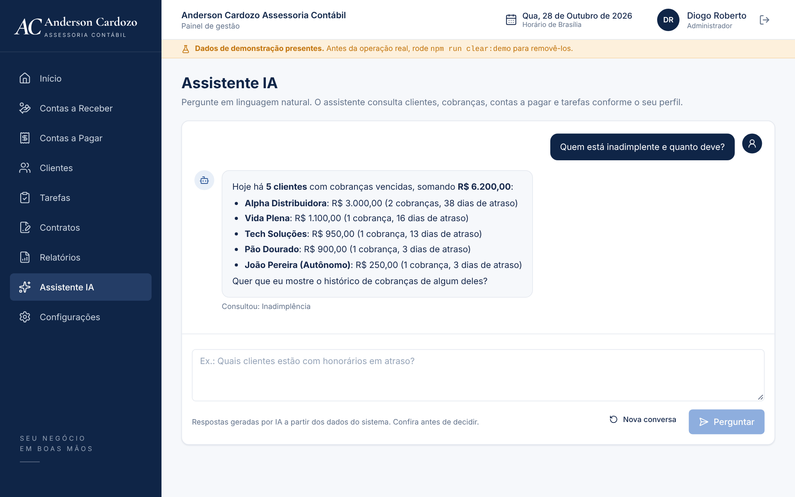
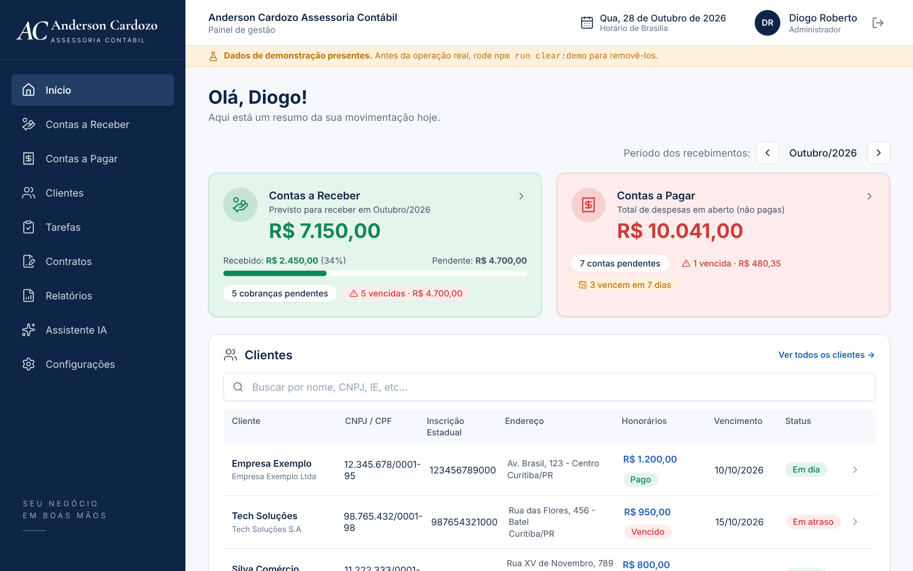
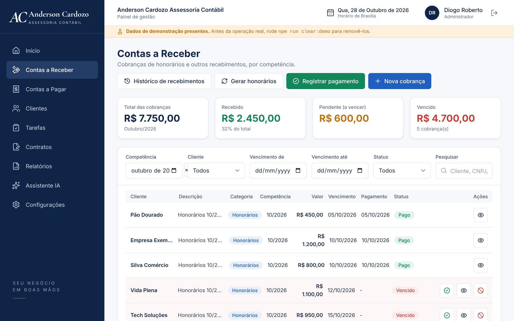
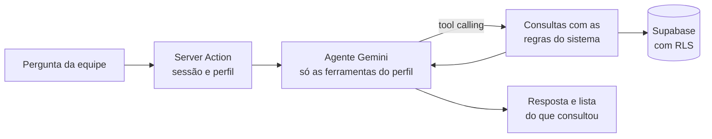

# Gestão Contábil

 
 


Sistema web de gestão para um escritório de contabilidade: clientes (mensalistas e eventuais), contas a receber
(honorários e serviços avulsos parcelados), contas a pagar, tarefas recorrentes do escritório, contratos com
modelos e relatórios, com permissões por perfil (Administrador, Contador, Financeiro e Operador).
**Desenvolvido para um escritório real.**

Inclui um **assistente de IA** que responde perguntas sobre os dados do escritório em linguagem natural.

### Destaques técnicos
- **Agente de IA com tool calling**, somente leitura e com ferramentas liberadas conforme o perfil (detalhes abaixo).
- **Segurança em camadas**: permissões aplicadas no banco (RLS) e conferidas de novo no servidor; nada é excluído
  (cancela/inativa) e as alterações ficam em log de auditoria.
- **Integridade financeira**: pagamentos e recorrências por funções SQL atômicas e idempotentes; status de
  cobrança derivado de datas e pagamentos, nunca digitado.
- **Contratos** gerados no servidor a partir de modelos com campos e trechos condicionais, com numeração sem repetição.

## Telas

<p align="center"><sub>Assistente IA: o agente consultou a inadimplência e respondeu com os valores calculados pelo sistema.</sub></p>

<p align="center">
  
  
</p>
<p align="center"><sub>Painel · Contas a receber — telas reais do sistema, com os dados de demonstração do projeto (<code>npm run seed:demo</code>).</sub></p>

## Tecnologias
Next.js 15 (App Router, Server Actions) · React 19 · TypeScript · Tailwind CSS · Supabase (Postgres, Auth e RLS) ·
React Hook Form + Zod · AI SDK + Google Gemini (tool calling) · Vitest · hospedagem na Vercel.

## Assistente de IA
Em **Assistente IA**, a equipe pergunta como falaria — *"quem está inadimplente e quanto deve?"*,
*"quanto já recebemos este mês?"*, *"quais tarefas estão atrasadas?"* — e um agente de IA consulta os dados
e responde, mostrando abaixo da resposta o que consultou.

**Como funciona**
1. A tela envia a conversa a uma Server Action, que confere a sessão e o perfil.
2. Um agente (AI SDK + Gemini) escolhe entre ferramentas de consulta (**tool calling**): buscar clientes,
   resumo do mês, inadimplência, cobranças de um cliente, contas a pagar e tarefas.
3. **O modelo não faz contas.** Cada ferramenta calcula com as mesmas regras que o sistema já usa nas telas
   (`services/finance.ts` e `services/tasks.ts`: status derivado, resumo do mês, situação do cliente, urgência das
   tarefas) e devolve os números prontos em R$. O modelo só escolhe as ferramentas e redige a resposta.
4. Os dados são carregados sob demanda, com o cliente Supabase da pessoa logada.



**Segurança**
- **Somente leitura:** nenhuma ferramenta grava, altera ou exclui. Pedidos de alteração são direcionados às telas.
- **Respeita o perfil:** o agente só recebe as ferramentas que o perfil pode usar. Um Operador não vê o
  financeiro, e o modelo nem fica sabendo que essas ferramentas existem. A RLS do banco continua valendo.
- **Privacidade:** nenhuma ferramenta envia CPF/CNPJ, telefone, e-mail ou endereço ao modelo.
- Instruções contra *prompt injection*, histórico limitado (12 mensagens, 1.000 caracteres cada), respostas
  renderizadas sem HTML vindo do modelo, chave só no servidor e código de IA fora do bundle do navegador.
- Sem chave configurada, o item do menu fica escondido.

**Arquitetura**
```
src/lib/ai/model.ts              único lugar que conhece o provedor (trocar Gemini por Claude/OpenAI/Groq = mudar só ele)
src/lib/ai/assistant/agent.ts    agente: ferramentas por perfil, instruções e laço de tool calling
src/lib/ai/assistant/queries.ts  consultas puras sobre os dados, reaproveitando as regras do sistema
src/app/(app)/assistente/        página e Server Action
src/components/assistant/        chat
```
Os testes (`npm test`) cobrem as consultas com dados de exemplo e o agente com um modelo simulado
(`MockLanguageModelV4`), sem chamar a API: ferramentas por perfil, resultado das ferramentas voltando ao modelo,
histórico e tratamento de erros.

**Para ativar:** crie uma chave gratuita no [Google AI Studio](https://aistudio.google.com/apikey) e coloque em
`GOOGLE_GENERATIVE_AI_API_KEY` no `.env.local` (e na Vercel, se quiser, como variável de servidor, sem
`NEXT_PUBLIC_`). No plano gratuito o Google pode usar o conteúdo enviado para melhorar os produtos dele: use-o
com dados de demonstração (`npm run seed:demo`) e o plano pago com dados reais.

## Instalação e execução local
```bash
npm install
cp .env.local.example .env.local   # preencha (ver docs/SUPABASE.md)
npm run dev                        # http://localhost:3000
```
Configuração do banco, perfis e dados de demonstração: [docs/SUPABASE.md](docs/SUPABASE.md).
Publicação, segurança e backup: [docs/DEPLOY.md](docs/DEPLOY.md).

## Comandos
| Comando | O que faz |
|---|---|
| `npm run dev` | Servidor de desenvolvimento. |
| `npm run build` / `npm start` | Compila e executa a versão de produção. |
| `npm run typecheck` | Verificação de tipos. |
| `npm test` | Testes do assistente de IA (Vitest). |
| `npm run seed` / `npm run seed:demo` | Cria o administrador (e, com `:demo`, dados de demonstração). |
| `npm run clear:demo` | Remove só os dados de demonstração. |
| `npm run seed:contratos` | Cadastra os modelos de contrato de `docs/modelos/`. |
| `npm run backup` / `npm run restore` | Cópia de segurança e restauração (ver `docs/DEPLOY.md`). |

## Autor
**Diogo Roberto** — desenvolvedor full-stack, estudante de Análise e Desenvolvimento de Sistemas (FIAP).
[LinkedIn](https://www.linkedin.com/in/diogo-roberto-b56899317/) · [GitHub](https://github.com/diogoroberto24)
